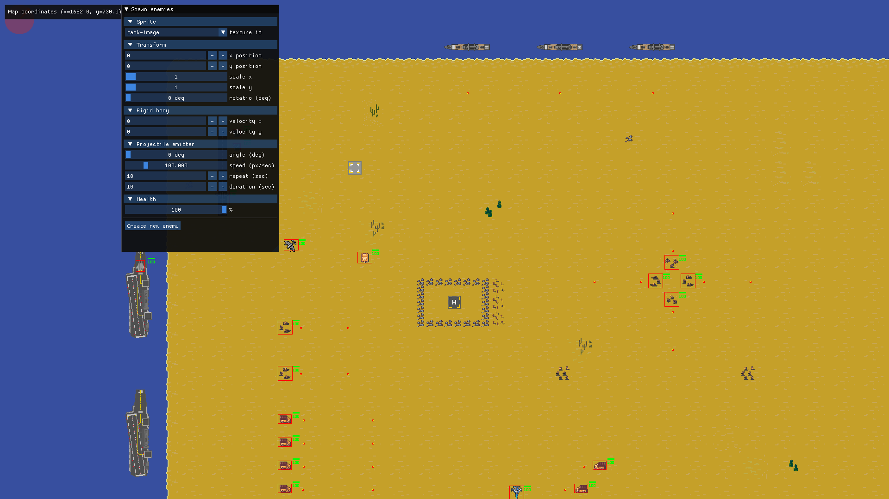
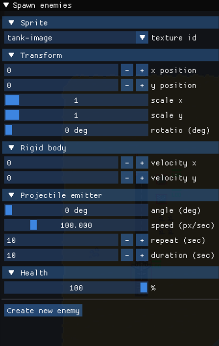
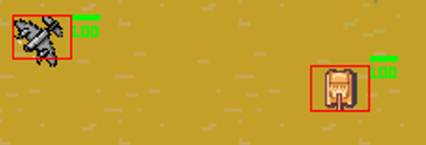

# ns2dEngine: 数据驱动 2D Game Engine


**ns2dEngine** 是一个基于现代 C++ (C++17) 从零独立构建的轻量级 2D 游戏引擎。
本项目旨在深入探索商业游戏引擎的底层原理，原生采用了 **ECS 架构**与**数据导向设计**。同时集成了事件总线、Lua 脚本热重载、ImGui 实时调试等现代化引擎标配模块。

<p align="center">
  
  <br>
  <i>图 1：引擎实际运行效果展示</i>
</p>


---

## 核心架构与技术亮点 

### 1. 纯正的 ECS 架构
为了解决传统游戏开发中“类爆炸”和“多重继承带来的菱形困境”，本引擎采用了纯 ECS 架构。
* **Entity**: 仅作为唯一 ID 存在，不包含任何逻辑或数据。
* **Component **: 纯数据结构，实现了数据的连续内存分布，提高 CPU 缓存命中率。引擎内置了丰富的组件库，如 `Transform`, `RigidBody`, `Sprite`, `BoxCollider`, `Health`, `ProjectileEmitter` 等。
* **System **: 纯逻辑模块。通过定义组件签名，系统会自动匹配并处理拥有特定组件集合的实体。包含 `MovementSystem`, `CollisionSystem`, `DamageSystem`, `RenderSystem` 等。

### 2. 跨语言脚本驱动
引擎内嵌了 Lua 5.3 虚拟机，并通过 Sol2 库实现了 C++ 与 Lua 的高效绑定，实现了真正的**数据与逻辑分离**。
* **数据驱动关卡**: 场景实体、组件参数、纹理资源均由 Lua 脚本（如 `level1.lua`）进行配置和加载（`LevelLoader`）。
* **逻辑脚本化**: 支持为特定实体挂载 `ScriptComponent`，允许游戏策划或开发者直接编写 Lua 脚本（如 `myscript.lua`）来控制 NPC 行为逻辑，缩短业务逻辑的迭代周期。

<p align="center">
  
  <br>
  <i>图 2：基于 Dear ImGui 的运行时可视化调试与 ECS 实体属性检查</i>
</p>


### 3. 解耦的事件总线系统
实现了一个基于发布-订阅 (Pub/Sub) 模式的强类型泛型事件总线，彻底解耦了各个 System 之间的通信。
* 例如：`CollisionSystem` 仅负责检测 AABB 碰撞，当检测到碰撞时，抛出 `CollisionEvent`。而 `DamageSystem` 订阅该事件，在接收到事件后才执行具体的生命值扣减逻辑。

### 4. 健壮的资源池化管理
* `AssetStore` 模块集中管理了所有的外部资源（Textures, Fonts, Audio）。
* 实现了资源的按需加载与统一释放，有效避免了资源重复加载带来的内存浪费与内存泄漏问题。

### 5. 渲染与可视化系统 
* 封装 SDL2 实现高性能的多图层 2D 渲染管线。
* 支持平滑的**摄像机跟随** (`CameraMovementSystem`)，支持大地图场景漫游。
* 支持动画帧播放 (`AnimationSystem`)、字体渲染及血条 UI。
* 深度集成 **Dear ImGui**，提供运行时的开发者调试面板，可实时显示 AABB 碰撞包围盒，实现“所见即所得”的调试体验。

<p align="center">
  
  <br>
  <i>图 3：运行时 AABB 包围盒可视化与物理碰撞调试</i>
</p>


---

## 技术栈

| 模块 | 技术 / 库 |
| :--- | :--- |
| **核心编程语言** | `C++` (大量使用智能指针、模板、泛型编程等特性) |
| **图形/输入/音频** | `SDL2` (SDL2_image, SDL2_ttf, SDL2_mixer) |
| **脚本引擎** | `Lua 5.3` + `Sol2` |
| **数学运算** | `GLM` |
| **开发者 GUI** | `Dear ImGui` |

---

## 📂 源码目录结构

```text
ns2dEngine/
├── assets/             # 游戏资产（Sprite、音效、字体、Tilemap 关卡数据及 Lua 脚本）
├── libs/               # 第三方静态库与头文件 (GLM, ImGui, Lua, Sol)
├── src/                # 引擎核心 C++ 源码
│   ├── AssetStore/     # 统一资源池管理模块
│   ├── Components/     # ECS 组件库 (定义了大量结构体，如 TransformComponent)
│   ├── ECS/            # ECS 核心调度器 (Registry, Entity, System 的基础实现)
│   ├── EventBus/       # 事件发布/订阅系统
│   ├── Events/         # 预定义事件 (CollisionEvent, KeyPressedEvent 等)
│   ├── Game/           # 游戏主循环 (Game.cpp) 与关卡加载器 (LevelLoader.cpp)
│   ├── Logger/         # 自定义分级日志输出系统
│   └── Systems/        # ECS 具体逻辑系统 (Movement, Damage, Render, Scripting...)
└── ns2dEngine.sln      # Visual Studio 解决方案文件
```
## 物理系统升级

已加入 OBB/圆形碰撞、固定步长、刚体冲量响应、摩擦、触发器和碰撞过滤。详见 [物理系统说明](docs/物理系统说明.md)，包含演示关卡、构建测试命令和面试讲解。

## ECS 基础完善

已加入带版本号的实体句柄、稀疏索引组件池、遍历期间的延迟结构变更、系统成员同步和生命周期回归测试。详见 [ECS 设计与验证](docs/ECS设计与验证.md)。

## 小型场景编辑器

运行 `.build/cmake/ns2dEngine.exe --editor` 打开对象列表、组件检查器、暂停/单步、画面选取与拖动、保存/加载功能。F2 切换编辑模式，F5 暂停/运行，F6 单步，Ctrl+S 保存。详见 [场景编辑器使用与设计](docs/场景编辑器使用与设计.md)。
