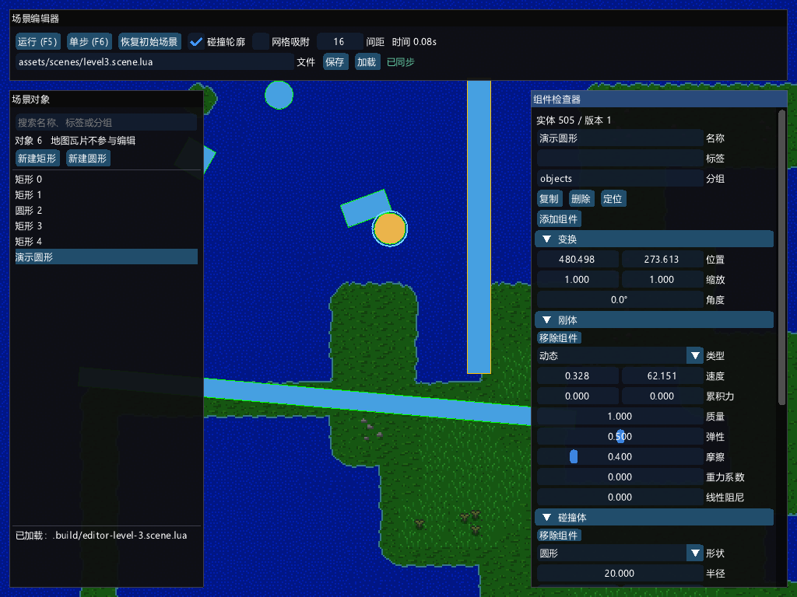

# 小型场景编辑器

现有生成敌人的调试窗口已升级为可操作的场景编辑器。可以选择、新建、复制和删除对象，修改组件，暂停或单步模拟，并把修改保存到独立场景文件后重新加载。



## 启动与操作

在项目根目录启动已构建的游戏：

```powershell
.\.build\cmake\ns2dEngine.exe --editor
```

默认打开第 2 关并暂停。也可以启动物理演示关卡的编辑模式：

```powershell
.\.build\cmake\ns2dEngine.exe --physics-demo --editor
```

支持 `--level=1`、`--level=2`、`--level=3` 选择基础关卡。运行中按 F2 或 D 进入暂停编辑，关闭编辑器时恢复运行。文字框正在输入时，D 不会触发模式切换。F5 切换运行/暂停，F6 暂停并只推进一个 1/120 秒的物理步，Ctrl+S 保存到顶部当前填写的路径。

| 区域 | 功能 |
| --- | --- |
| 顶部控制栏 | 运行、暂停、单步、恢复启动场景、碰撞轮廓、吸附设置、文件路径、保存与加载 |
| 左侧对象列表 | 按名称、标签或分组搜索；新建矩形、圆形；选择实体 |
| 右侧组件检查器 | 编辑组件参数、添加/移除组件、复制、删除及定位 |
| 场景画面 | 点击选取，左键拖动移动对象，中键拖动平移视图，选中对象显示蓝色轮廓 |

修改组件或拖动对象会自动暂停，以便观察编辑结果。网格吸附只作用于画面中的拖动；数值框可精确输入任意位置。文字对象可以在列表中选择并编辑文字位置，当前没有提供对文字边界的画面拾取。

顶部恢复按钮会替换当前对象配置，使用确认弹窗。存在未保存修改时，点击加载也会先提示确认。加载失败的信息显示在左侧状态区域。

## 组件与创建能力

检查器支持变换、刚体、矩形/圆形碰撞体、形状外观、精灵、动画、生命值、子弹发射器、键盘控制、文字、摄像机跟随和脚本启用状态。资源下拉框列出当前关卡已加载的真实纹理或字体 ID，不再使用旧窗口里写死且可能不存在的资源名。

新建矩形和圆形默认带变换、刚体、碰撞体和填充外观，退出编辑模式后仍然可见。形状外观绘制在精灵之后；为对象添加精灵后，改用精灵显示。用户可以改变填充颜色、质量、重力系数、摩擦和弹性等参数。默认重力系数为零，设为 1 后物体会下落。

复制使用新实体句柄，复制组件值与脚本来源，将位置平移 24 像素；不复制唯一标签或摄像机跟随标记。删除后选择立即清除，实体在下一次 ECS 提交时销毁。

移除精灵时也移除动画和键盘控制；移除刚体时移除键盘控制；移除碰撞体时移除形状外观。变换是对象的基础组件，已有变换不提供移除按钮。游戏伤害与发射回调也补充了缺失组件检查，避免编辑组合时直接访问不存在的组件。

脚本可能每步覆盖对象的位置或速度。在检查器关闭“启用脚本”后，可以稳定编辑这些数值。当前不提供脚本源码编辑；原关卡中的脚本可以移除后通过“恢复原关卡脚本”恢复，没有原脚本的对象会显示明确失败信息。

## 保存与加载

默认路径为 `assets/scenes/level2.scene.lua` 或对应基础关卡的文件名。也可修改为其他相对或绝对路径，文件名必须以 `.scene.lua` 结尾，避免把对象快照误写到原始关卡或源码文件中。

文件保存以下内容：

- 格式版本、基础关卡编号、模拟时间。
- 对象名称、原关卡来源、标签和分组。
- 可编辑组件的完整值，包括精灵图层/裁切/翻转、碰撞掩码、动画状态、发射计时、文字颜色及形状颜色。
- 脚本在原关卡中的来源索引和启用状态。

地图瓦片和运行时子弹不属于可编辑对象，不写入快照。背景地图、资源清单和脚本函数定义仍来自原 Lua 关卡；场景文件应在相同基础关卡下加载。它是对当前对象状态的持久化，不是独立资源包，也不修改原 `level1.lua/level2.lua/level3.lua`。

加载先在独立的 Lua 状态中读取数据，该状态不开放标准库并具有执行指令上限。检查版本、数量、字段类型、数值范围、组件依赖、唯一标签，再检查当前关卡是否具备对应资源与脚本。全部验证成功后，保留背景瓦片，替换对象并清除运行时子弹，恢复模拟时间，重新匹配 ECS 系统。旧对象句柄失效，选择清空，模拟保持暂停。

非法文件、版本不符、缺失资源、无效脚本来源等可预期错误都在替换前拒绝，不清空当前对象。内存分配失败等异常不承诺整个加载过程回滚。文件大小上限为 8 MB，对象数量上限为 10000。

保存使用临时文件写入和原子替换，校验或写入失败时保留原文件。中文名称、中文路径、引号、换行和反斜杠都经过往返测试；读取支持 UTF-8 BOM。界面中文字体在当前 Windows 环境使用系统微软雅黑，不把系统字体复制进项目。

## 暂停与单步的实现

引入 `SimulationClock`，刚体、Lua 更新、动画、发射器和子弹寿命都使用模拟时间。暂停时继续处理窗口、输入、编辑器和 ECS 提交，但不推进模拟时间或执行游戏系统。真实时间流逝不会使暂停中的子弹过期，也不会触发发射或跳过动画。

单步消费一次请求，执行一个固定物理步并继续暂停。进入暂停会丢弃物理时钟中尚未消费的积压，恢复运行不会补算整个暂停时长。该时钟沿用当前单线程、单个活动游戏实例的架构。

输入先传给 ImGui。编辑器捕获的键盘输入不再同时控制玩家；暂停期间不发送游戏按键事件。在画面中点击对象会解除面板的键盘焦点，便于恢复运行后操作场景。

## 文件入口与验证

- `src/Editor/SceneEditor.*`：对象操作、选择、拾取、请求处理、捕获与恢复。
- `src/Editor/SceneSerializer.*`：格式、验证、原子保存与数据读取。
- `src/Editor/SceneData.h`：独立于运行时实体 ID 的可保存数据。
- `src/Systems/RenderGUISystem.*`：控制栏、对象列表、检查器与视口交互。
- `src/Systems/RenderPrimitiveSystem.h`：矩形和圆形的填充绘制。
- `src/Time/SimulationClock.h`：暂停与单步共享的模拟时钟。
- `src/Components/SceneObjectComponent.h`：编辑器对象名称与脚本来源。

构建和运行测试：

```powershell
cmake --build .build/cmake --parallel 4
ctest --test-dir .build/cmake --output-on-failure
```

测试覆盖对象创建、复制、删除、吸附与拾取；中文和特殊字符序列化；碰撞掩码、物理参数及外观往返；无效文件和缺失资源拒绝；原文件保护；原关卡函数恢复；真实游戏暂停、单步、计时冻结以及第 2/3 关的保存加载。

界面测试用 SDL 软件渲染器和 ImGui 鼠标/键盘输入实际点击运行、暂停、单步、新建、保存、加载按钮，拖动对象、平移视图、输入路径，并通过检查器拖动字段修改刚体质量。测试使用 dummy 驱动，不操作用户桌面的鼠标或剪贴板。

当前版本没有撤销/重做、地图绘制、资源导入浏览器、父子层级、变换手柄和脚本源码编辑。下一步可以在现有请求与场景数据层上加入可撤销编辑命令。
